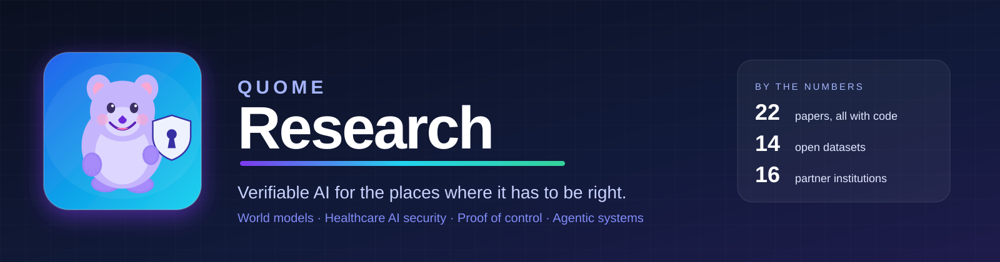
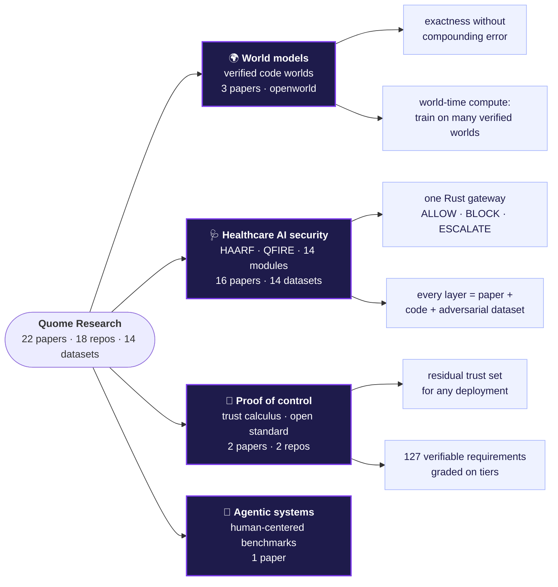
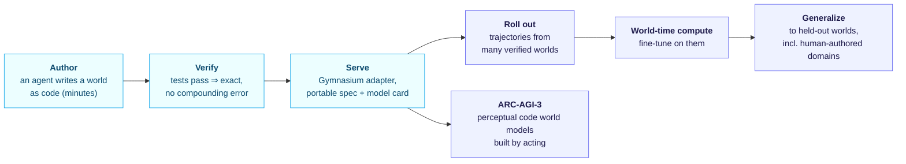
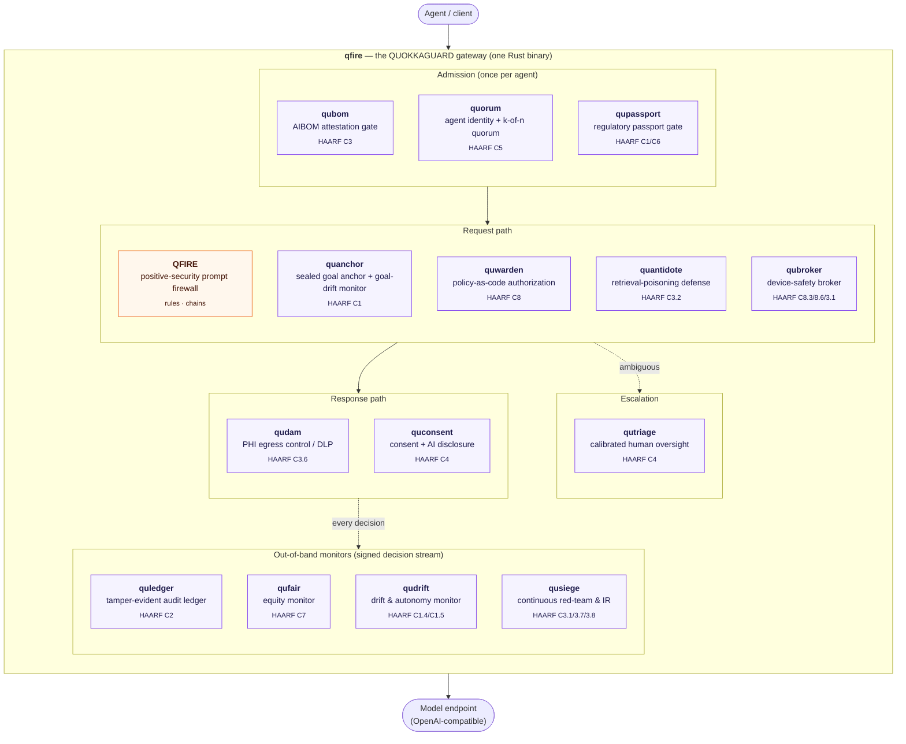
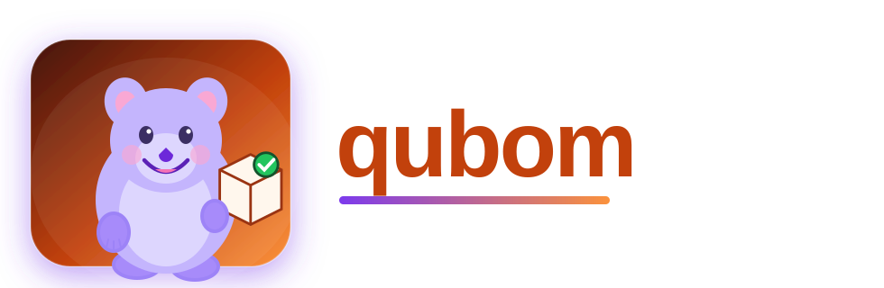
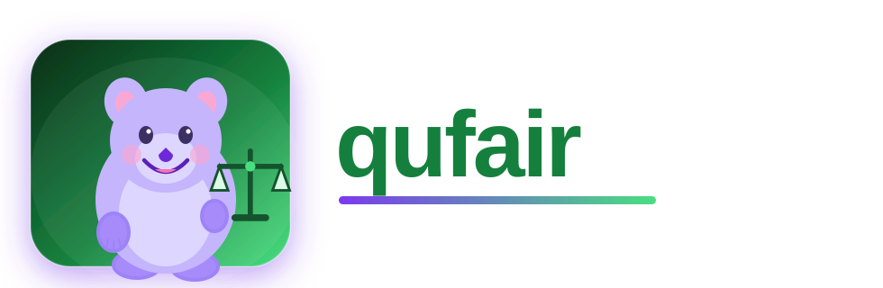
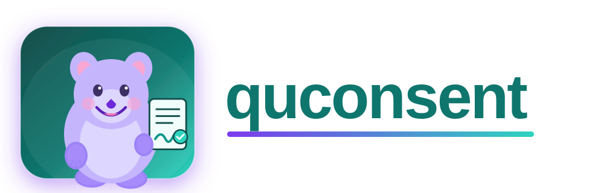
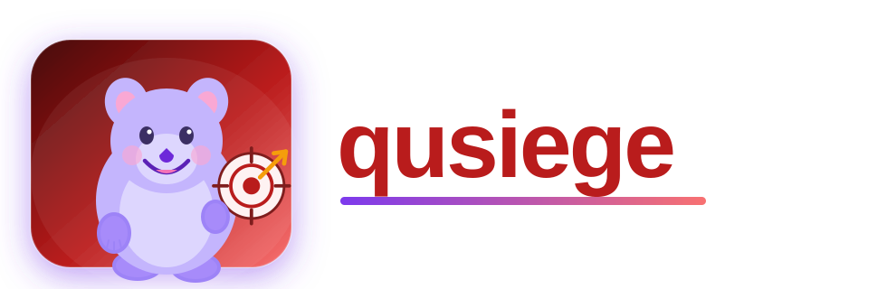
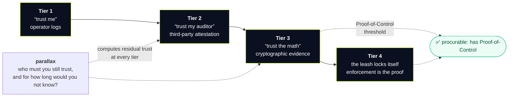
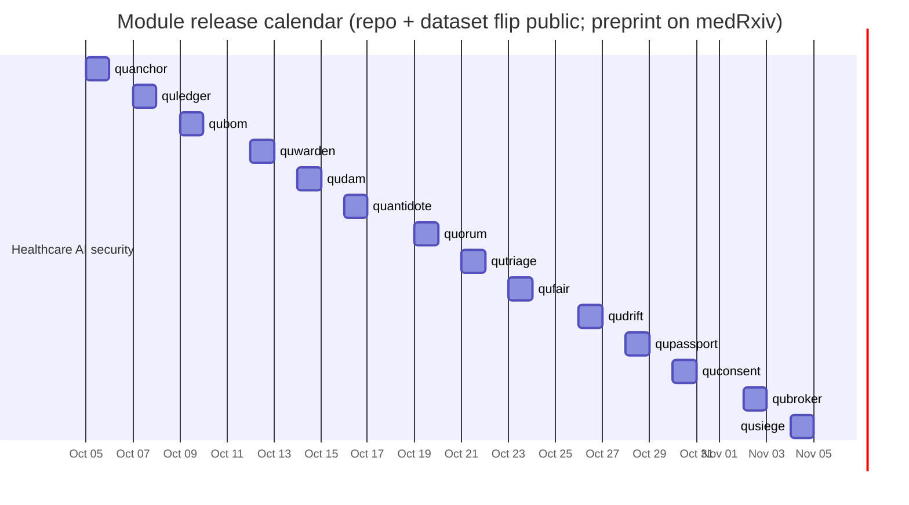

<div align="center">



### Research you can run. Every paper ships with its code, its data, and its numbers.

     

[World models](#-world-models) · [Healthcare AI security](#-healthcare-ai-security) · [Proof of control](#-proof-of-control--verification) · [Agentic systems](#-agentic-systems--evaluation) · [Release calendar](#-release-calendar) · [Collaborators](#-collaborators) · [Cite](#-cite)

</div>

---

**Quome builds AI for regulated, high-stakes environments, and we publish the evidence.** One question, asked in three settings: *how do you know an autonomous system did what it was supposed to?* For clinical agents the answer is a security gateway you can audit. For world models it is code you can verify instead of video you can only watch. For AI governance it is proof of control anyone can check without trusting the operator.



> Every result is reproducible from a public repository on local hardware with no paid model keys. Datasets are synthetic and released on Hugging Face with full data cards. Papers cite each other by module name, so each one stands alone.

## 🤝 Collaborators

| | |
|---|---|
| **[Task Force for AI Agents in Healthcare](https://aihealthagents.org/)** | Clinicians, security engineers and regulators defining how autonomous agents are verified before they touch patient care. Home of HAARF. |
| **[Advanced AI Society](https://advancedaisociety.org/)** | Steward of the Proof-of-Control Initiative: open standards for verifying what AI agents actually did, in a form anyone can check. |

<sub>**16 institutions across 22 papers** (superscripts below): <sup>1</sup> [Quome, Inc.](https://quome.com) · <sup>2</sup> Fusen World LLC · <sup>3</sup> Independent · <sup>4</sup> [OWASP](https://owasp.org/) · <sup>5</sup> [IEEE Computer Society](https://www.computer.org/) · <sup>6</sup> Rafter Labs, Inc. · <sup>7</sup> [University of Washington](https://www.washington.edu/) · <sup>8</sup> Health Stream Analytics, LLC · <sup>9</sup> [Task Force for AI Agents in Healthcare](https://aihealthagents.org/) · <sup>10</sup> [Institute on Human Development and Disability, University of Washington](https://ihdd.uw.edu/) · <sup>11</sup> TammNet · <sup>12</sup> Velocity AI · <sup>13</sup> [Health-ISAC](https://health-isac.org/) · <sup>14</sup> Move37 Labs · <sup>15</sup> [Advanced AI Society](https://advancedaisociety.org/) · <sup>16</sup> [Cloud Security Alliance](https://cloudsecurityalliance.org/)</sub>

---

## 🌍 World models

*Verified code world models: simulators an agent can author in minutes, that stay exact, and that teach models to generalize.*



<p align="center"><a href="https://github.com/quome-cloud/openworld"></a><br/><sub>From the OpenWorld papers: verified code stays exact (accuracy 1.0) where learned simulators compound error. <a href="https://github.com/quome-cloud/openworld">openworld</a> is the open-source substrate.</sub></p>


### World-Time Compute with Verified Code World Models

Verified code world models have no compounding error, and fine-tuning on trajectories from many verified worlds lifts generalization to held-out worlds, including a real human-authored domain.

<sub>James Schwoebel<sup>1</sup>, Ingrida Semenec<sup>1</sup>, Jenia Rousseva<sup>1</sup>, Marcos Ortiz<sup>1</sup>, Collin Overbay<sup>1</sup>, Christopher Klaus<sup>2</sup>, Anderson Edmond<sup>3</sup>, Manish Bhatt<sup>4,5</sup>, Rome Thorstenson<sup>6</sup>, Jessica Tsai<sup>1</sup>, Martin G. Frasch<sup>7,8</sup> · *arXiv preprint arXiv:2609.09163, 2026*</sub>

[📄 Paper](https://arxiv.org/abs/2609.09163) · [PDF](https://arxiv.org/pdf/2609.09163) · [💻 `openworld`](https://github.com/quome-cloud/openworld) · [Cite](#cite-schwoebel2026worldtime)

### World Computing: Prototyping and Evaluating Verified Code World Models

The OpenWorld substrate: an agent authors a structurally-validated, servable world in minutes; a formal composition algebra, portable specs and model cards, and a six-sector benchmark run on local 7B–9B models with no training.

<sub>James Schwoebel<sup>1</sup>, Ingrida Semenec<sup>1</sup>, Jenia Rousseva<sup>1</sup>, Marcos Ortiz<sup>1</sup>, Collin Overbay<sup>1</sup>, Christopher Klaus<sup>2</sup>, Anderson Edmond<sup>3</sup>, Manish Bhatt<sup>4,5</sup>, Rome Thorstenson<sup>6</sup>, Jessica Tsai<sup>1</sup>, Martin G. Frasch<sup>7,8</sup> · *Preprint, 2026*</sub>

[📄 Paper](https://github.com/quome-cloud/openworld/blob/main/papers/framework/main.pdf) · [PDF](https://github.com/quome-cloud/openworld/raw/main/papers/framework/main.pdf) · [💻 `openworld`](https://github.com/quome-cloud/openworld) · [Cite](#cite-schwoebel2026worldcomputing)

### Solving ARC-AGI-3 with Perceptual Code World Models

Verified code world models built by acting, a source-free audited protocol, the goal-as-procedure diagnosis, and an atlas of serveable per-game world models for ARC-AGI-3.

<sub>James Schwoebel<sup>1</sup>, Ingrida Semenec<sup>1</sup>, Jenia Rousseva<sup>1</sup>, Marcos Ortiz<sup>1</sup>, Collin Overbay<sup>1</sup>, Christopher Klaus<sup>2</sup>, Manish Bhatt<sup>4,5</sup>, Rome Thorstenson<sup>6</sup>, Jessica Tsai<sup>1</sup>, Martin G. Frasch<sup>7,8</sup> · *Technical report, 2026*</sub>

[📄 Paper](https://github.com/quome-cloud/openworld/blob/main/papers/arc-3/main.pdf) · [PDF](https://github.com/quome-cloud/openworld/raw/main/papers/arc-3/main.pdf) · [💻 `openworld`](https://github.com/quome-cloud/openworld) · [Cite](#cite-schwoebel2026arcagi3)

---

## 🩺 Healthcare AI security

*A regulatory framework, a positive-security prompt firewall, and fourteen enforcement modules, each a standalone paper with code and an adversarial dataset, that together make autonomous clinical agents verifiable.*



<p align="center"><sub>One binary. Each module is a standalone paper, a `src/` layer in the gateway, and an adversarial dataset. Click a logo to open its repository.</sub></p>

<table align="center"><tr><td align="center" width="14%"><a href="https://github.com/quome-cloud/quanchor"><br/><sub><b>quanchor</b><br/>sealed goal anchor + goal-drift monitor</sub></a></td><td align="center" width="14%"><a href="https://github.com/quome-cloud/quledger"><br/><sub><b>quledger</b><br/>tamper-evident audit ledger</sub></a></td><td align="center" width="14%"><a href="https://github.com/quome-cloud/qubom"><br/><sub><b>qubom</b><br/>AIBOM attestation gate</sub></a></td><td align="center" width="14%"><a href="https://github.com/quome-cloud/quwarden"><br/><sub><b>quwarden</b><br/>policy-as-code authorization</sub></a></td><td align="center" width="14%"><a href="https://github.com/quome-cloud/qudam"><br/><sub><b>qudam</b><br/>PHI egress control / DLP</sub></a></td><td align="center" width="14%"><a href="https://github.com/quome-cloud/quantidote"><br/><sub><b>quantidote</b><br/>retrieval-poisoning defense</sub></a></td><td align="center" width="14%"><a href="https://github.com/quome-cloud/quorum"><br/><sub><b>quorum</b><br/>agent identity + k-of-n quorum</sub></a></td></tr><tr><td align="center" width="14%"><a href="https://github.com/quome-cloud/qutriage"><br/><sub><b>qutriage</b><br/>calibrated human oversight</sub></a></td><td align="center" width="14%"><a href="https://github.com/quome-cloud/qufair"><br/><sub><b>qufair</b><br/>equity monitor</sub></a></td><td align="center" width="14%"><a href="https://github.com/quome-cloud/qudrift"><br/><sub><b>qudrift</b><br/>drift & autonomy monitor</sub></a></td><td align="center" width="14%"><a href="https://github.com/quome-cloud/qupassport"><br/><sub><b>qupassport</b><br/>regulatory passport gate</sub></a></td><td align="center" width="14%"><a href="https://github.com/quome-cloud/quconsent"><br/><sub><b>quconsent</b><br/>consent + AI disclosure</sub></a></td><td align="center" width="14%"><a href="https://github.com/quome-cloud/qubroker"><br/><sub><b>qubroker</b><br/>device-safety broker</sub></a></td><td align="center" width="14%"><a href="https://github.com/quome-cloud/qusiege"><br/><sub><b>qusiege</b><br/>continuous red-team & IR</sub></a></td></tr></table>

### The framework and the firewall

### HAARF: Healthcare AI Agents Regulatory Framework — A Comprehensive Security Verification Standard for Autonomous AI Systems in Clinical Environments <sub>framework</sub>

The governance framework (controls C1–C8) that every module below implements. Written with the Task Force for AI Agents in Healthcare.

<sub>Jim Schwoebel<sup>1,9</sup>, Martin Frasch<sup>8,10,9</sup>, Art Spalding<sup>11,9</sup>, Ed Sewell<sup>12,9</sup>, Phil Englert<sup>13,9</sup>, Ben Halpert<sup>1,9</sup>, Collin Overbay<sup>1,9</sup>, Ingrida Semenec<sup>1,9</sup>, Joel Shor<sup>14,1,9</sup> · *medRxiv preprint, 2026*</sub>

[📄 Paper](https://www.medrxiv.org/content/10.64898/2026.04.09.26350519v1) · [PDF](https://www.medrxiv.org/content/10.64898/2026.04.09.26350519v1.full.pdf) · [Cite](#cite-schwoebel2026haarf)

### Beyond Injection Detection: A Positive-Security Prompt Firewall that Closes the Scope and PHI Gap SOTA Classifiers Miss in Healthcare <sub>open source</sub>

QFIRE: a Rust prompt firewall (proxy, CLI, 100+ rules, benchmark harness) that enforces purpose scope and PHI boundaries that state-of-the-art injection classifiers miss.

<sub>James Schwoebel<sup>1,9</sup>, Ingrida Semenec<sup>1,9</sup>, Jenia Rousseva<sup>1,9</sup>, Martin G. Frasch<sup>7,8,9</sup>, Rome Thorstenson<sup>6,9</sup>, Manish Bhatt<sup>4,5,9</sup> · *medRxiv preprint, 2026*</sub>

[📄 Paper](https://www.medrxiv.org/content/10.64898/2026.06.04.26354950v1) · [PDF](https://www.medrxiv.org/content/10.64898/2026.06.04.26354950v1.full.pdf) · [💻 `qfire`](https://github.com/Task-force-for-AI-agents-in-Healthcare/qfire) · [Cite](#cite-schwoebel2026qfire)

### The fourteen modules

<sub>All authored at Quome, Inc.<sup>1</sup> (James Schwoebel and the QUOKKAGUARD contributors). Each row is a full paper; full BibTeX under [Cite](#-cite).</sub>

| Module | Paper | Headline result | Links |
|---|---|---|---|
| **`quanchor`**<br/><sub>HAARF C1</sub> | **Pristine Weights, Poisoned Goals: Intent-Mutation Attacks on Self-Improving Clinical Agents and Attestation-Rooted Harness Defenses** | Attack success rate (M2): 0.94-1.00 on every model of 3.8B or more; llama3.2 3B 0.40 [0.30, 0.51]; gpt-oss 120B 0.81 [0.71, 0.88] | [paper](https://github.com/quome-cloud/quanchor/blob/main/papers/002-pristine-weights/main.pdf) · [code](https://github.com/quome-cloud/quanchor) · [🤗 data](https://huggingface.co/datasets/Quome/intentbench) · [cite](#cite-schwoebel2026quanchor) |
| **`quledger`**<br/><sub>HAARF C2</sub> | **Tamper-Evident Action Provenance for Confidential Clinical AI Agents** | Tamper detection rate (E1): 100% (26/26 tampered logs) | [paper](https://github.com/quome-cloud/quledger/blob/main/papers/003-tamper-audit/main.pdf) · [code](https://github.com/quome-cloud/quledger) · [🤗 data](https://huggingface.co/datasets/Quome/tamperbench) · [cite](#cite-schwoebel2026quledger) |
| **`qubom`**<br/><sub>HAARF C3</sub> | **AI Supply-Chain Integrity for Confidential Clinical Agents: AIBOM Attestation and the Provenance Gap** | Supply-chain detection coverage (E1): 100% (15/15) | [paper](https://github.com/quome-cloud/qubom/blob/main/papers/004-supply-chain/main.pdf) · [code](https://github.com/quome-cloud/qubom) · [🤗 data](https://huggingface.co/datasets/Quome/supplychainbench) · [cite](#cite-schwoebel2026qubom) |
| **`quwarden`**<br/><sub>HAARF C8</sub> | **Policy-as-Code Authorization for Clinical AI Agents: Context-Aware Decisions and a Cedar-vs-Rego Comparison** | Over-permission rate (OPR): 42.9% static RBAC vs 0% Cedar/Rego | [paper](https://github.com/quome-cloud/quwarden/blob/main/papers/005-policy-authz/main.pdf) · [code](https://github.com/quome-cloud/quwarden) · [🤗 data](https://huggingface.co/datasets/Quome/policybench) · [cite](#cite-schwoebel2026quwarden) |
| **`qudam`**<br/><sub>HAARF C3.6</sub> | **PHI Egress Control and Covert-Channel Defense for Clinical AI Agents** | Encoded exfil prevented (X2): taint 60/60 vs regex 0/60 vs LLM-NER (llama3.1:8b) 0/60 | [paper](https://github.com/quome-cloud/qudam/blob/main/papers/006-phi-egress/main.pdf) · [code](https://github.com/quome-cloud/qudam) · [🤗 data](https://huggingface.co/datasets/Quome/exfilbench) · [cite](#cite-schwoebel2026qudam) |
| **`quantidote`**<br/><sub>HAARF C3.2</sub> | **Resisting Memory and Retrieval Poisoning in Clinical AI Agents: Provenance-Scored Retrieval over a Quantized Index** | Poison attack success (PAS), targeted queries: 100% undefended to 0% with the full stack (provenance-only 9.1%) | [paper](https://github.com/quome-cloud/quantidote/blob/main/papers/007-rag-poisoning/main.pdf) · [code](https://github.com/quome-cloud/quantidote) · [🤗 data](https://huggingface.co/datasets/Quome/poisonbench) · [cite](#cite-schwoebel2026quantidote) |
| **`quorum`**<br/><sub>HAARF C5</sub> | **Who Is Calling? Cryptographic Agent Identity for Malicious Agents in Multi-Agent Clinical Systems** | Attack success with no identity layer: 100% (90/90), 95% Wilson CI [95.9%, 100%] | [paper](https://github.com/quome-cloud/quorum/blob/main/papers/008-multi-agent/main.pdf) · [code](https://github.com/quome-cloud/quorum) · [🤗 data](https://huggingface.co/datasets/Quome/mabench) · [cite](#cite-schwoebel2026quorum) |
| **`qutriage`**<br/><sub>HAARF C4</sub> | **Calibrating Human Oversight for Clinical AI Agents: Routing Only the Ambiguous Tail to Clinicians** | Policy-control false-block rate on legitimate actions (E1): 28.3% | [paper](https://github.com/quome-cloud/qutriage/blob/main/papers/009-hitl-calibration/main.pdf) · [code](https://github.com/quome-cloud/qutriage) · [🤗 data](https://huggingface.co/datasets/Quome/triagebench) · [cite](#cite-schwoebel2026qutriage) |
| **`qufair`**<br/><sub>HAARF C7</sub> | **Equity-Aware Enforcement: When the Guardrail Itself Becomes a Fairness Hazard** | Live gateway race enforcement gap, max pairwise (E1): 13.6% (0 of 5 axes significant at audit N; overall enforcement 12.0%) | [paper](https://github.com/quome-cloud/qufair/blob/main/papers/010-equity/main.pdf) · [code](https://github.com/quome-cloud/qufair) · [🤗 data](https://huggingface.co/datasets/Quome/equitybench) · [cite](#cite-schwoebel2026qufair) |
| **`qudrift`**<br/><sub>HAARF C1.4/C1.5</sub> | **Watching the Deployment, Not the Call: Continuous Performance and Drift Monitoring for Deployed Clinical Agents** | Drift detection rate and ROC AUC per detector (E1): CUSUM 54/54, AUC 1.00; conformal 54/54, AUC 1.00; distance 54/54, AUC 1.00; ADWIN 36/54, AUC 0.83 | [paper](https://github.com/quome-cloud/qudrift/blob/main/papers/011-drift-monitoring/main.pdf) · [code](https://github.com/quome-cloud/qudrift) · [🤗 data](https://huggingface.co/datasets/Quome/haarf-drift) · [cite](#cite-schwoebel2026qudrift) |
| **`qupassport`**<br/><sub>HAARF C1/C6</sub> | **The Regulatory Passport: Lifecycle and Change-Control Automation for Clinical AI Agents** | Classification accuracy (CLA): 0.992 (95% CI [0.981, 0.996]) | [paper](https://github.com/quome-cloud/qupassport/blob/main/papers/012-passport/main.pdf) · [code](https://github.com/quome-cloud/qupassport) · [🤗 data](https://huggingface.co/datasets/Quome/passportbench) · [cite](#cite-schwoebel2026qupassport) |
| **`quconsent`**<br/><sub>HAARF C4</sub> | **Consent Is a Gateway Responsibility: Enforcing Patient Consent, AI Disclosure, and Participatory Governance for Clinical AI Agents** | Spontaneous AI-involvement disclosure (live llama3.1:8b, n=120): 0.0% un-gated -> 100.0% gated | [paper](https://github.com/quome-cloud/quconsent/blob/main/papers/013-consent/main.pdf) · [code](https://github.com/quome-cloud/quconsent) · [🤗 data](https://huggingface.co/datasets/Quome/consentbench) · [cite](#cite-schwoebel2026quconsent) |
| **`qubroker`**<br/><sub>HAARF C8.3/8.6/3.1</sub> | **Fail Closed at the Bedside: A Device-Safety Broker for Agents that Actuate Life-Critical Medical Devices** | Unsafe-actuation rate (live llama3.1:8b, n=216): 53.7% broker-off -> 0.0% broker-on (95% CI upper bound 1.7%) | [paper](https://github.com/quome-cloud/qubroker/blob/main/papers/014-device-broker/main.pdf) · [code](https://github.com/quome-cloud/qubroker) · [🤗 data](https://huggingface.co/datasets/Quome/devicebench) · [cite](#cite-schwoebel2026qubroker) |
| **`qusiege`**<br/><sub>HAARF C3.1/3.7/3.8</sub> | **Defenses That Pass Once and Rot: Continuous Red-Teaming, Incident Response, and Resilience as a Meta-Layer for Clinical AI Guardrails** | Distinct vulnerabilities discovered (E1): 62 continuous vs 12 one-shot (50 more) | [paper](https://github.com/quome-cloud/qusiege/blob/main/papers/015-redteam/main.pdf) · [code](https://github.com/quome-cloud/qusiege) · [🤗 data](https://huggingface.co/datasets/Quome/haarf-redteam) · [cite](#cite-schwoebel2026qusiege) |

---

## 🔏 Proof of control & verification

*Replacing "trust me" with evidence anyone can check: a calculus for what attestation really buys you, and an open standard for proving what an agent did.*



<p align="center"><a href="https://github.com/AAI-Society/parallax"></a></p>


### A Trust Calculus for Attestation Tiers: Computing Residual Trust and Testing Whether Deployments Can Be Ranked <sub>open source</sub>

parallax: describe a deployment and it computes the residual trust set, every party whose dishonesty would change the answer, what each could do, and how long you would not know. Attestation moves trust; it does not remove it.

<sub>Jim Schwoebel<sup>1,15</sup> · *Advanced AI Society, Proof-of-Control Initiative — working draft v0.1, 2026*</sub>

[📄 Paper](https://github.com/AAI-Society/parallax/blob/main/paper/main.pdf) · [PDF](https://github.com/AAI-Society/parallax/raw/main/paper/main.pdf) · [💻 `parallax`](https://github.com/AAI-Society/parallax) · [Cite](#cite-schwoebel2026parallax)

### Proof-of-Control: An Open Standard for Runtime Verifiability and Cryptographic Oversight in Autonomous AI Execution <sub>open standard</sub>

The Proof-of-Control Standard: 127 verifiable requirements across six domains, graded on Verifiability Tiers, so "does your AI have Proof-of-Control?" becomes a procurable yes/no.

<sub>Tricia Wang<sup>15</sup>, Ken Huang<sup>15,16</sup>, Jim Schwoebel<sup>15,1</sup> · *Advanced AI Society, Proof-of-Control Initiative — working draft v0.1, 2026*</sub>

[📄 Paper](https://github.com/LFDT-ProofOfControl/ov-poc-standard/blob/main/paper/main.pdf) · [PDF](https://github.com/LFDT-ProofOfControl/ov-poc-standard/raw/main/paper/main.pdf) · [💻 `ov-poc-standard`](https://github.com/LFDT-ProofOfControl/ov-poc-standard) · [Cite](#cite-wang2026proofofcontrol)

<p align="center"><a href="https://github.com/LFDT-ProofOfControl/ov-poc-standard"></a><br/><sub>The Verifiability Tiers from the Proof-of-Control Standard (Advanced AI Society).</sub></p>

---

## 🤖 Agentic systems & evaluation

*Measuring what agentic software actually delivers to the people who use it.*

### From Prompt to Product: A Human-Centered Benchmark of Agentic App Generation Systems

96 prompts, 288 generated apps, 205 human raters and 1,071 pairwise comparisons across Replit, Bolt and Firebase Studio: visual polish and functional reliability come apart, and only interactive, task-based evaluation sees it.

<sub>Marcos Ortiz<sup>1</sup>, Justin Hill<sup>1</sup>, Collin Overbay<sup>1</sup>, Ingrida Semenec<sup>1</sup>, Frederic Sauve-Hoover<sup>1</sup>, Jim Schwoebel<sup>1</sup>, Joel Shor<sup>14,1</sup> · *arXiv preprint arXiv:2512.18080, 2025*</sub>

[📄 Paper](https://arxiv.org/abs/2512.18080) · [PDF](https://arxiv.org/pdf/2512.18080) · [Cite](#cite-ortiz2025prompttoproduct)

---

## 📅 Release calendar

The fourteen healthcare-security modules go public one at a time, each with its preprint, repository, and dataset on the same day.



---

## 📚 Cite

All entries are in [`CITATIONS.bib`](CITATIONS.bib) and machine-readable in [`papers.json`](papers.json) (with per-author affiliations). Expand a section for BibTeX.

<details><summary><b>World models</b> (3)</summary>

<a id="cite-schwoebel2026worldtime"></a>
**World-Time Compute with Verified Code World Models**

```bibtex
@article{schwoebel2026worldtime,
  author        = {Schwoebel, James and Semenec, Ingrida and Rousseva, Jenia and Ortiz, Marcos and Overbay, Collin and Klaus, Christopher and Edmond, Anderson and Bhatt, Manish and Thorstenson, Rome and Tsai, Jessica and Frasch, Martin G.},
  title         = {World-Time Compute with Verified Code World Models},
  year          = {2026},
  journal       = {arXiv preprint arXiv:2609.09163},
  doi           = {10.48550/arXiv.2609.09163},
  eprint        = {2609.09163},
  archivePrefix = {arXiv}
}
```

<a id="cite-schwoebel2026worldcomputing"></a>
**World Computing: Prototyping and Evaluating Verified Code World Models**

```bibtex
@unpublished{schwoebel2026worldcomputing,
  author = {Schwoebel, James and Semenec, Ingrida and Rousseva, Jenia and Ortiz, Marcos and Overbay, Collin and Klaus, Christopher and Edmond, Anderson and Bhatt, Manish and Thorstenson, Rome and Tsai, Jessica and Frasch, Martin G.},
  title  = {World Computing: Prototyping and Evaluating Verified Code World Models},
  year   = {2026},
  note   = {Preprint. \url{https://github.com/quome-cloud/openworld}}
}
```

<a id="cite-schwoebel2026arcagi3"></a>
**Solving ARC-AGI-3 with Perceptual Code World Models**

```bibtex
@unpublished{schwoebel2026arcagi3,
  author = {Schwoebel, James and Semenec, Ingrida and Rousseva, Jenia and Ortiz, Marcos and Overbay, Collin and Klaus, Christopher and Bhatt, Manish and Thorstenson, Rome and Tsai, Jessica and Frasch, Martin G.},
  title  = {Solving ARC-AGI-3 with Perceptual Code World Models},
  year   = {2026},
  note   = {Technical report. \url{https://github.com/quome-cloud/openworld}}
}
```

</details>

<details><summary><b>Healthcare AI security</b> (16)</summary>

<a id="cite-schwoebel2026haarf"></a>
**HAARF: Healthcare AI Agents Regulatory Framework — A Comprehensive Security Verification Standard for Autonomous AI Systems in Clinical Environments**

```bibtex
@unpublished{schwoebel2026haarf,
  author = {Schwoebel, Jim and Frasch, Martin and Spalding, Art and Sewell, Ed and Englert, Phil and Halpert, Ben and Overbay, Collin and Semenec, Ingrida and Shor, Joel},
  title  = {HAARF: Healthcare AI Agents Regulatory Framework — A Comprehensive Security Verification Standard for Autonomous AI Systems in Clinical Environments},
  year   = {2026},
  note   = {medRxiv preprint},
  month  = {April},
  doi    = {10.64898/2026.04.09.26350519},
  url    = {https://www.medrxiv.org/content/10.64898/2026.04.09.26350519v1}
}
```

<a id="cite-schwoebel2026qfire"></a>
**Beyond Injection Detection: A Positive-Security Prompt Firewall that Closes the Scope and PHI Gap SOTA Classifiers Miss in Healthcare**

```bibtex
@article{schwoebel2026qfire,
  author  = {Schwoebel, James and Semenec, Ingrida and Rousseva, Jenia and Frasch, Martin G. and Thorstenson, Rome and Bhatt, Manish},
  title   = {Beyond Injection Detection: A Positive-Security Prompt Firewall that Closes the Scope and PHI Gap SOTA Classifiers Miss in Healthcare},
  year    = {2026},
  journal = {medRxiv},
  doi     = {10.64898/2026.06.04.26354950},
  url     = {https://www.medrxiv.org/content/10.64898/2026.06.04.26354950v1},
  note    = {Preprint}
}
```

<a id="cite-schwoebel2026quanchor"></a>
**Pristine Weights, Poisoned Goals: Intent-Mutation Attacks on Self-Improving Clinical Agents and Attestation-Rooted Harness Defenses**

```bibtex
@unpublished{schwoebel2026quanchor,
  author = {Schwoebel, James},
  title  = {Pristine Weights, Poisoned Goals: Intent-Mutation Attacks on Self-Improving Clinical Agents and Attestation-Rooted Harness Defenses},
  note   = {Preprint. Quome, QUOKKAGUARD program (quanchor module)},
  year   = {2026},
  url    = {https://github.com/quome-cloud/quanchor}
}
```

<a id="cite-schwoebel2026quledger"></a>
**Tamper-Evident Action Provenance for Confidential Clinical AI Agents**

```bibtex
@unpublished{schwoebel2026quledger,
  author = {Schwoebel, James},
  title  = {Tamper-Evident Action Provenance for Confidential Clinical AI Agents},
  note   = {Preprint. Quome, QUOKKAGUARD program (quledger module)},
  year   = {2026},
  url    = {https://github.com/quome-cloud/quledger}
}
```

<a id="cite-schwoebel2026qubom"></a>
**AI Supply-Chain Integrity for Confidential Clinical Agents: AIBOM Attestation and the Provenance Gap**

```bibtex
@unpublished{schwoebel2026qubom,
  author = {Schwoebel, James},
  title  = {AI Supply-Chain Integrity for Confidential Clinical Agents: AIBOM Attestation and the Provenance Gap},
  note   = {Preprint. Quome, QUOKKAGUARD program (qubom module)},
  year   = {2026},
  url    = {https://github.com/quome-cloud/qubom}
}
```

<a id="cite-schwoebel2026quwarden"></a>
**Policy-as-Code Authorization for Clinical AI Agents: Context-Aware Decisions and a Cedar-vs-Rego Comparison**

```bibtex
@unpublished{schwoebel2026quwarden,
  author = {Schwoebel, James},
  title  = {Policy-as-Code Authorization for Clinical AI Agents: Context-Aware Decisions and a Cedar-vs-Rego Comparison},
  note   = {Preprint. Quome, QUOKKAGUARD program (quwarden module)},
  year   = {2026},
  url    = {https://github.com/quome-cloud/quwarden}
}
```

<a id="cite-schwoebel2026qudam"></a>
**PHI Egress Control and Covert-Channel Defense for Clinical AI Agents**

```bibtex
@unpublished{schwoebel2026qudam,
  author = {Schwoebel, James},
  title  = {PHI Egress Control and Covert-Channel Defense for Clinical AI Agents},
  note   = {Preprint. Quome, QUOKKAGUARD program (qudam module)},
  year   = {2026},
  url    = {https://github.com/quome-cloud/qudam}
}
```

<a id="cite-schwoebel2026quantidote"></a>
**Resisting Memory and Retrieval Poisoning in Clinical AI Agents: Provenance-Scored Retrieval over a Quantized Index**

```bibtex
@unpublished{schwoebel2026quantidote,
  author = {Schwoebel, James},
  title  = {Resisting Memory and Retrieval Poisoning in Clinical AI Agents: Provenance-Scored Retrieval over a Quantized Index},
  note   = {Preprint. Quome, QUOKKAGUARD program (quantidote module)},
  year   = {2026},
  url    = {https://github.com/quome-cloud/quantidote}
}
```

<a id="cite-schwoebel2026quorum"></a>
**Who Is Calling? Cryptographic Agent Identity for Malicious Agents in Multi-Agent Clinical Systems**

```bibtex
@unpublished{schwoebel2026quorum,
  author = {Schwoebel, James},
  title  = {Who Is Calling? Cryptographic Agent Identity for Malicious Agents in Multi-Agent Clinical Systems},
  note   = {Preprint. Quome, QUOKKAGUARD program (quorum module)},
  year   = {2026},
  url    = {https://github.com/quome-cloud/quorum}
}
```

<a id="cite-schwoebel2026qutriage"></a>
**Calibrating Human Oversight for Clinical AI Agents: Routing Only the Ambiguous Tail to Clinicians**

```bibtex
@unpublished{schwoebel2026qutriage,
  author = {Schwoebel, James},
  title  = {Calibrating Human Oversight for Clinical AI Agents: Routing Only the Ambiguous Tail to Clinicians},
  note   = {Preprint. Quome, QUOKKAGUARD program (qutriage module)},
  year   = {2026},
  url    = {https://github.com/quome-cloud/qutriage}
}
```

<a id="cite-schwoebel2026qufair"></a>
**Equity-Aware Enforcement: When the Guardrail Itself Becomes a Fairness Hazard**

```bibtex
@unpublished{schwoebel2026qufair,
  author = {Schwoebel, Jim and {QUOKKAGUARD Contributors}},
  title  = {Equity-Aware Enforcement: When the Guardrail Itself Becomes a Fairness Hazard},
  note   = {Preprint. Quome, QUOKKAGUARD program (qufair module)},
  year   = {2026},
  url    = {https://github.com/quome-cloud/qufair}
}
```

<a id="cite-schwoebel2026qudrift"></a>
**Watching the Deployment, Not the Call: Continuous Performance and Drift Monitoring for Deployed Clinical Agents**

```bibtex
@unpublished{schwoebel2026qudrift,
  author = {Schwoebel, Jim and {QUOKKAGUARD Contributors}},
  title  = {Watching the Deployment, Not the Call: Continuous Performance and Drift Monitoring for Deployed Clinical Agents},
  note   = {Preprint. Quome, QUOKKAGUARD program (qudrift module)},
  year   = {2026},
  url    = {https://github.com/quome-cloud/qudrift}
}
```

<a id="cite-schwoebel2026qupassport"></a>
**The Regulatory Passport: Lifecycle and Change-Control Automation for Clinical AI Agents**

```bibtex
@unpublished{schwoebel2026qupassport,
  author = {{QUOKKAGUARD Project}},
  title  = {The Regulatory Passport: Lifecycle and Change-Control Automation for Clinical AI Agents},
  note   = {Preprint. Quome, QUOKKAGUARD program (qupassport module)},
  year   = {2026},
  url    = {https://github.com/quome-cloud/qupassport}
}
```

<a id="cite-schwoebel2026quconsent"></a>
**Consent Is a Gateway Responsibility: Enforcing Patient Consent, AI Disclosure, and Participatory Governance for Clinical AI Agents**

```bibtex
@unpublished{schwoebel2026quconsent,
  author = {{QUOKKAGUARD Working Group}},
  title  = {Consent Is a Gateway Responsibility: Enforcing Patient Consent, AI Disclosure, and Participatory Governance for Clinical AI Agents},
  note   = {Preprint. Quome, QUOKKAGUARD program (quconsent module)},
  year   = {2026},
  url    = {https://github.com/quome-cloud/quconsent}
}
```

<a id="cite-schwoebel2026qubroker"></a>
**Fail Closed at the Bedside: A Device-Safety Broker for Agents that Actuate Life-Critical Medical Devices**

```bibtex
@unpublished{schwoebel2026qubroker,
  author = {Schwoebel, Jim and {QUOKKAGUARD Contributors}},
  title  = {Fail Closed at the Bedside: A Device-Safety Broker for Agents that Actuate Life-Critical Medical Devices},
  note   = {Preprint. Quome, QUOKKAGUARD program (qubroker module)},
  year   = {2026},
  url    = {https://github.com/quome-cloud/qubroker}
}
```

<a id="cite-schwoebel2026qusiege"></a>
**Defenses That Pass Once and Rot: Continuous Red-Teaming, Incident Response, and Resilience as a Meta-Layer for Clinical AI Guardrails**

```bibtex
@unpublished{schwoebel2026qusiege,
  author = {Schwoebel, Jim and {QUOKKAGUARD Contributors}},
  title  = {Defenses That Pass Once and Rot: Continuous Red-Teaming, Incident Response, and Resilience as a Meta-Layer for Clinical AI Guardrails},
  note   = {Preprint. Quome, QUOKKAGUARD program (qusiege module)},
  year   = {2026},
  url    = {https://github.com/quome-cloud/qusiege}
}
```

</details>

<details><summary><b>Proof of control & verification</b> (2)</summary>

<a id="cite-schwoebel2026parallax"></a>
**A Trust Calculus for Attestation Tiers: Computing Residual Trust and Testing Whether Deployments Can Be Ranked**

```bibtex
@unpublished{schwoebel2026parallax,
  author = {Schwoebel, Jim},
  title  = {A Trust Calculus for Attestation Tiers: Computing Residual Trust and Testing Whether Deployments Can Be Ranked},
  year   = {2026},
  note   = {Working draft v0.1, Proof-of-Control Initiative, Advanced AI Society. \url{https://github.com/AAI-Society/parallax}},
  month  = {August}
}
```

<a id="cite-wang2026proofofcontrol"></a>
**Proof-of-Control: An Open Standard for Runtime Verifiability and Cryptographic Oversight in Autonomous AI Execution**

```bibtex
@unpublished{wang2026proofofcontrol,
  author = {Wang, Tricia and Huang, Ken and Schwoebel, Jim},
  title  = {Proof-of-Control: An Open Standard for Runtime Verifiability and Cryptographic Oversight in Autonomous AI Execution},
  year   = {2026},
  note   = {Working draft v0.1, Proof-of-Control Initiative, Advanced AI Society. \url{https://github.com/LFDT-ProofOfControl/ov-poc-standard}},
  month  = {August}
}
```

</details>

<details><summary><b>Agentic systems & evaluation</b> (1)</summary>

<a id="cite-ortiz2025prompttoproduct"></a>
**From Prompt to Product: A Human-Centered Benchmark of Agentic App Generation Systems**

```bibtex
@article{ortiz2025prompttoproduct,
  author        = {Ortiz, Marcos and Hill, Justin and Overbay, Collin and Semenec, Ingrida and Sauve-Hoover, Frederic and Schwoebel, Jim and Shor, Joel},
  title         = {From Prompt to Product: A Human-Centered Benchmark of Agentic App Generation Systems},
  year          = {2025},
  journal       = {arXiv preprint arXiv:2512.18080},
  eprint        = {2512.18080},
  archivePrefix = {arXiv},
  url           = {https://arxiv.org/abs/2512.18080}
}
```

</details>


## Work with us

- **Reproduce something.** Each repository's README has a quickstart and an experiment table; open an issue there if a number doesn't regenerate.
- **Join the program.** The [Task Force for AI Agents in Healthcare](https://aihealthagents.org/) and the [Advanced AI Society](https://advancedaisociety.org/) both run open working groups.
- **Talk to us.** [jim@quome.com](mailto:jim@quome.com) · [quome.com](https://quome.com)

<div align="center"><sub>Apache License 2.0 · © 2026 Quome, Inc. · This page is generated from <code>papers.json</code>; last updated 2026-10-02.</sub></div>
